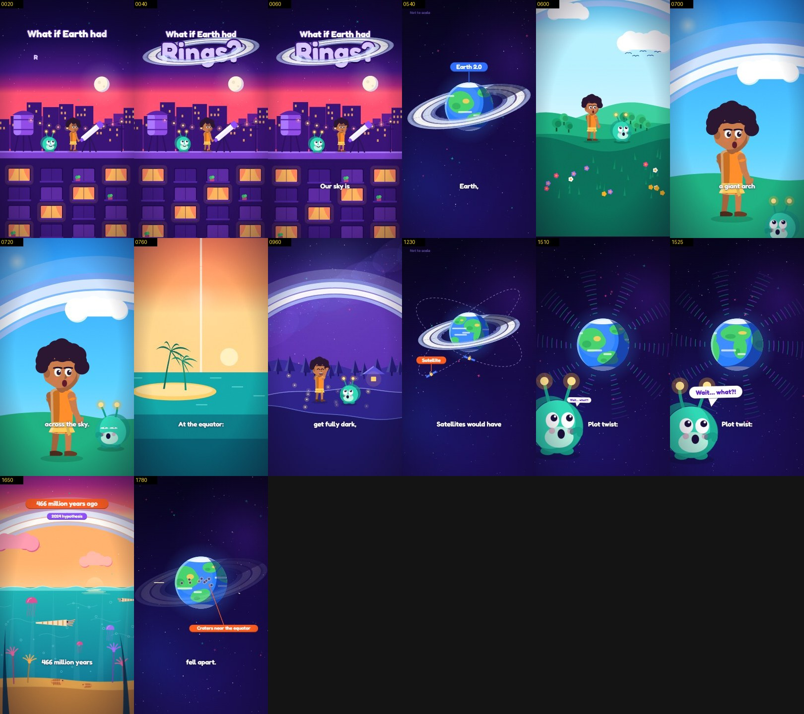

<div align="center">

# 🪐 neon-space-explainer

**A Claude skill that makes "What if…?" science reels from a single prompt.**

Neon flat-vector space art, an original kid + critter duo, punchy captions and an original score, all generated as code with [Remotion](https://remotion.dev).



<sub>Frames from the included example: <i>What if Earth had rings?</i> (65 s, vertical, wordless)</sub>

</div>

## What it does

Ask your agent *"make a reel about what would happen if Earth had rings"* and the skill runs the whole pipeline:

**beat sheet → fact check → cue sheet → scenes → score + SFX → review stills → render**

- **1080×1920, 30 fps** vertical video for Shorts, Reels and TikTok
- **Everything is code:** SVG scenes, motion helpers and a Web Audio score, so output is deterministic and 100% original (no stock assets)
- Deep navy/violet starfields, glowing two-tone planets, pill labels on leader lines, zoom-inset cards, dashed orbits, "Not to scale" tags
- Bold 2–3-word captions in the lower third
- Wordless by default, or add a voiceover with [Fish Audio](https://fish.audio)
- Facts are verified with web search and hedged on screen when they're hypotheses

## Install

Copy the folder into your project's skills directory:

```bash
git clone https://github.com/swarnasis154299/neon-space-explainer .claude/skills/neon-space-explainer
```

Then ask: *"Use the neon-space-explainer skill to make a reel about what if the Moon disappeared."*

## Start a project by hand

```bash
bash .claude/skills/neon-space-explainer/template/new_project.sh my-reel
cd my-reel && npm install && npx remotion studio
```

## What's inside

```
SKILL.md                 the full pipeline the agent follows
template/                Remotion starter: Space, Character, Art components, audio kit, scripts
examples/earth-rings/    complete scenes, score and timeline of the example reel
```

## License

MIT. See [LICENSE](LICENSE). Videos you make with it are yours.
